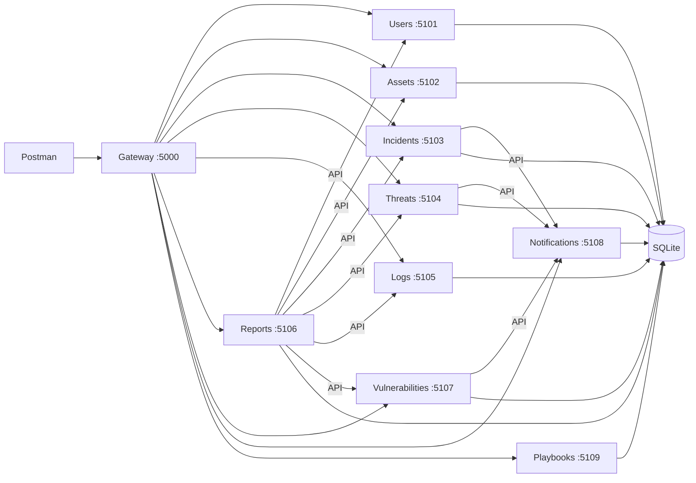
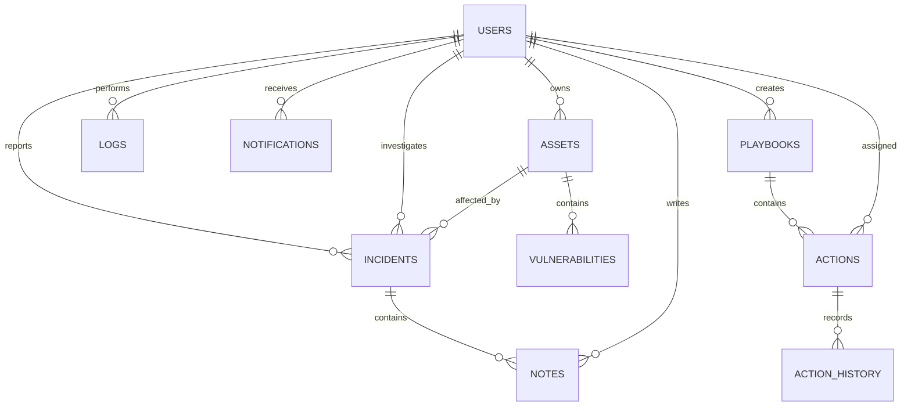

# Security Incident Detection and Response Backend

Sprint I backend for nine security management features. The API runs locally with Flask and SQLite. There is no frontend.

## Team feature map

| Feature | Route prefix | Responsible student |
| --- | --- | --- |
| 1. Users and identity | `/Khaled_Kanawati/users` | Khaled Kanawati |
| 2. Assets | `/Hasan_Zuelghina/assets` | Hasan Zuelghina |
| 3. Incidents | `/Mohamad_Zuelghina/incidents` | Mohamad Zuelghina |
| 4. Threat intelligence | `/Khaled_Kanawati/threats` | Khaled Kanawati |
| 5. Audit logs | `/Hasan_Zuelghina/logs` | Hasan Zuelghina |
| 6. Reports | `/Mohamad_Zuelghina/reports` | Mohamad Zuelghina |
| 7. Vulnerabilities | `/Khaled_Kanawati/vulnerabilities` | Khaled Kanawati |
| 8. Notifications | `/Hasan_Zuelghina/notifications` | Hasan Zuelghina |
| 9. Playbooks and response actions | `/Mohamad_Zuelghina/playbooks` | Mohamad Zuelghina |

This table assigns feature ownership for review. Git commits must be made by the person who actually reviews, changes, and submits each feature. See [Git workflow](#git-workflow).

## Run locally

Use Python 3.11 or newer. In a PowerShell terminal opened in this folder:

```powershell
python -m venv .venv
.\.venv\Scripts\Activate.ps1
pip install -r requirements.txt
$env:SECRET_KEY = 'replace-with-a-long-random-local-secret'
python manage.py seed-demo
python serve.py
```

The gateway listens at `http://127.0.0.1:5000` and forwards to nine local service processes on ports 5101–5109. `GET /health` shows the gateway is running. `seed-demo` adds four local demonstration users if absent. Their usernames are `admin`, `analyst`, `employee`, and `auditor`; each has password `DemoPass123!`. These credentials are for local demonstration only. SQLite data is saved at `data/security.db` and excluded from Git. Set `DATABASE` to another file path if needed. Stop the gateway and children with Ctrl+C. `python app.py` runs all route groups in one process for simple debugging.



## Postman

Import [the collection](postman/Security_Incident_Backend.postman_collection.json) and [the local environment](postman/Local.postman_environment.json). Select **Security Incident Backend Local**. Run the folders in order, starting with `0 Login`. Login scripts save role tokens; creation scripts save IDs for later requests. **Evidence checks** covers denied access, bad input, bad password, and missing records. **Delete demos** creates temporary records before deleting them, so the main records remain available. All 75 requests have ready-to-use bodies or parameters and response checks.

The complete endpoint list and request fields are in [API reference](docs/API.md). Normal success returns a JSON record or list. Errors use `{"status":"error","message":"..."}` with a suitable HTTP status.

## Authentication and validation

Passwords use Werkzeug's salted password hashing. Login issues a signed bearer token valid for 24 hours. Each protected endpoint checks the token, active account status, and role. Self-registered accounts are always Employees; only Administrators can create other roles or change roles and account status. Employees see only their own incidents and notifications. Analysts work on assigned incidents. Auditors have read-only access.

SQLite foreign keys preserve the relationships between records. The API validates required fields, email and IP formats, enum values, CVSS range, CVE shape, threat indicator formats, uniqueness, and ordered incident, vulnerability, and response action transitions. Parameterized SQL prevents SQL injection. Login, denied access, user creation, role changes, and record changes create audit records. With `serve.py`, nine local HTTP services share the SQLite database. Reports call the other services' APIs, and incident, threat, and vulnerability services call the notification API. The shared database keeps local setup small; it is a deliberate simplification from separately deployed databases.

## Tests

```powershell
python -m pytest -q
```

The tests use a separate temporary SQLite database and cover all nine feature areas, roles, ownership, invalid input, uniqueness, status transitions, audit events, reports, and every Postman request in collection order. Build or refresh Postman and API docs after changing routes:

```powershell
python tools/build_postman.py
```

## Database model



`db.py` contains the actual table definitions, primary keys, foreign keys, checks, and unique constraints. Its `Database` class encapsulates each request's connection, schema setup, queries, and cleanup; the services use the shared query helpers. This Mermaid diagram can be rendered in GitHub for the report. The full schema is created automatically when the app starts.

## Evidence and report

Follow [the screenshot guide](docs/SCREENSHOTS.md) while using the live API, Postman, SQLite viewer, and GitHub. Place actual screenshots in the matching `screenshots/` folders. The placeholders keep the folders in Git. The assignment requires a common report with captions, a table of contents, architecture and database diagrams, validation and access evidence, GitHub history, references, and an accurate statement of any AI assistance. The report is a separate team deliverable.

## Git workflow

The repository started empty. Its history is organized into `khaled`, `hasan`, and `mohamad` branches, with one feature commit per service in feature order, plus a shared scaffold and integration work. The team supplied the author names and emails; the implementation and commits were prepared with AI assistance on their behalf. Each member should review and explain their assigned features before submission. Commit authorship records the agreed feature ownership; it is not evidence that each person typed the code independently. The report should disclose the AI assistance accurately.

Suggested short pull request titles and descriptions, in feature order:

| Feature | Title | Description |
| --- | --- | --- |
| 1 | Add user APIs | Registration, login, profiles, roles, and account status. |
| 2 | Add asset APIs | Asset records, validation, and search. |
| 3 | Add incident APIs | Reporting, assignment, notes, and status workflow. |
| 4 | Add threat APIs | Indicators, validation, search, and alerts. |
| 5 | Add audit log APIs | Activity records, searches, and access checks. |
| 6 | Add report APIs | Summary and five security reports. |
| 7 | Add vulnerability APIs | Asset findings and remediation workflow. |
| 8 | Add notification APIs | Alerts, personal views, and read tracking. |
| 9 | Add playbook APIs | Ordered response actions and status history. |

## Project structure

```text
app.py                 Flask app and error handlers
serve.py               nine HTTP processes and one gateway
common.py              auth, validation, CRUD, audit helpers
db.py                  SQLite schema and access
services/              one module for each of the nine features
manage.py              local demonstration users
requirements.txt       Python dependencies
postman/               importable collection and environment
docs/API.md            endpoint reference
docs/SCREENSHOTS.md    evidence capture instructions
tests/test_api.py      API tests
tests/test_postman.py  full collection run
data/                  local SQLite file after first run
screenshots/           empty evidence folders for real captures
tools/build_postman.py regenerates Postman and API docs
```
